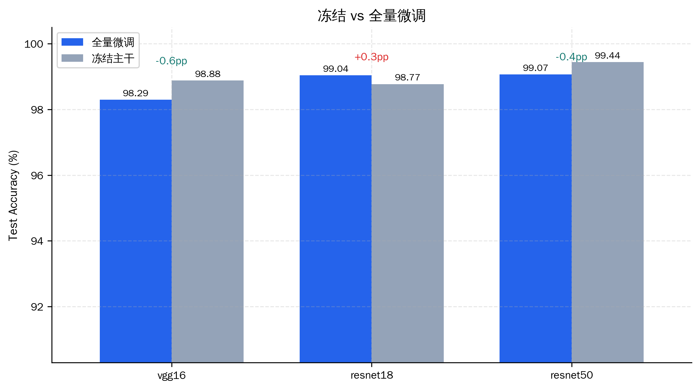
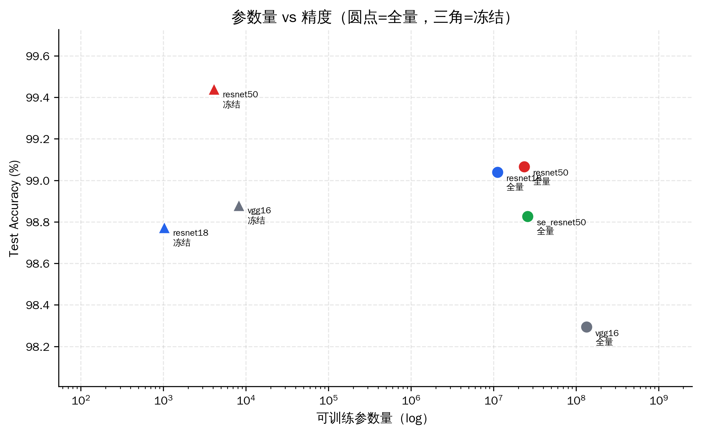
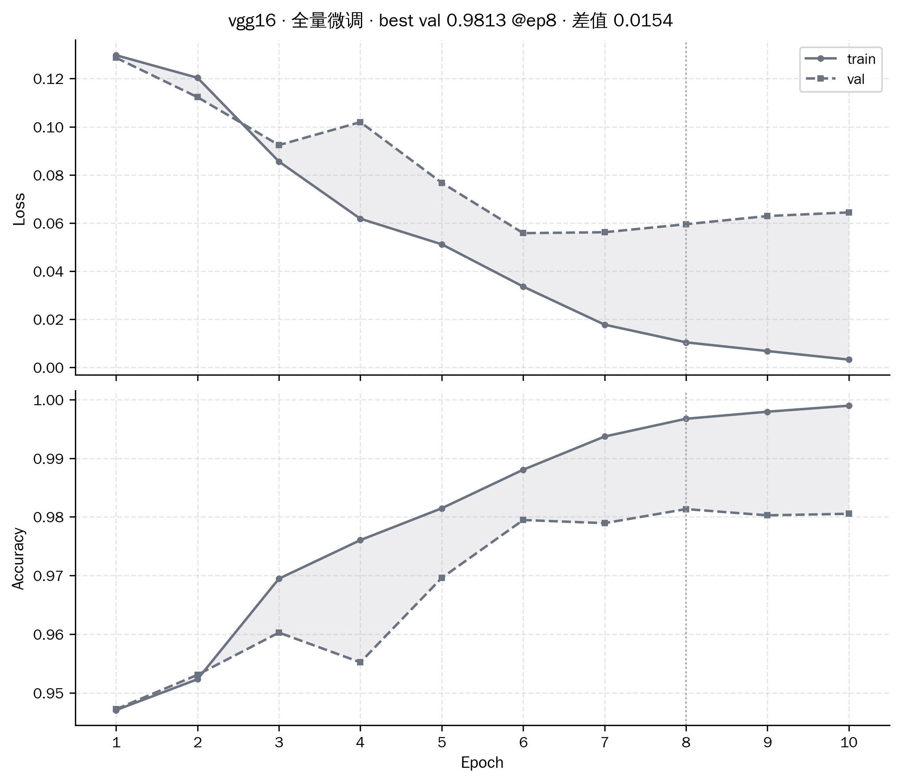
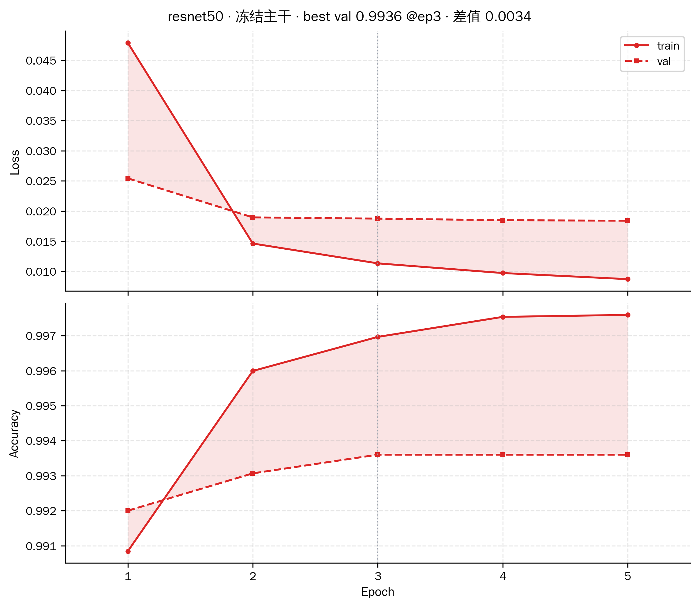
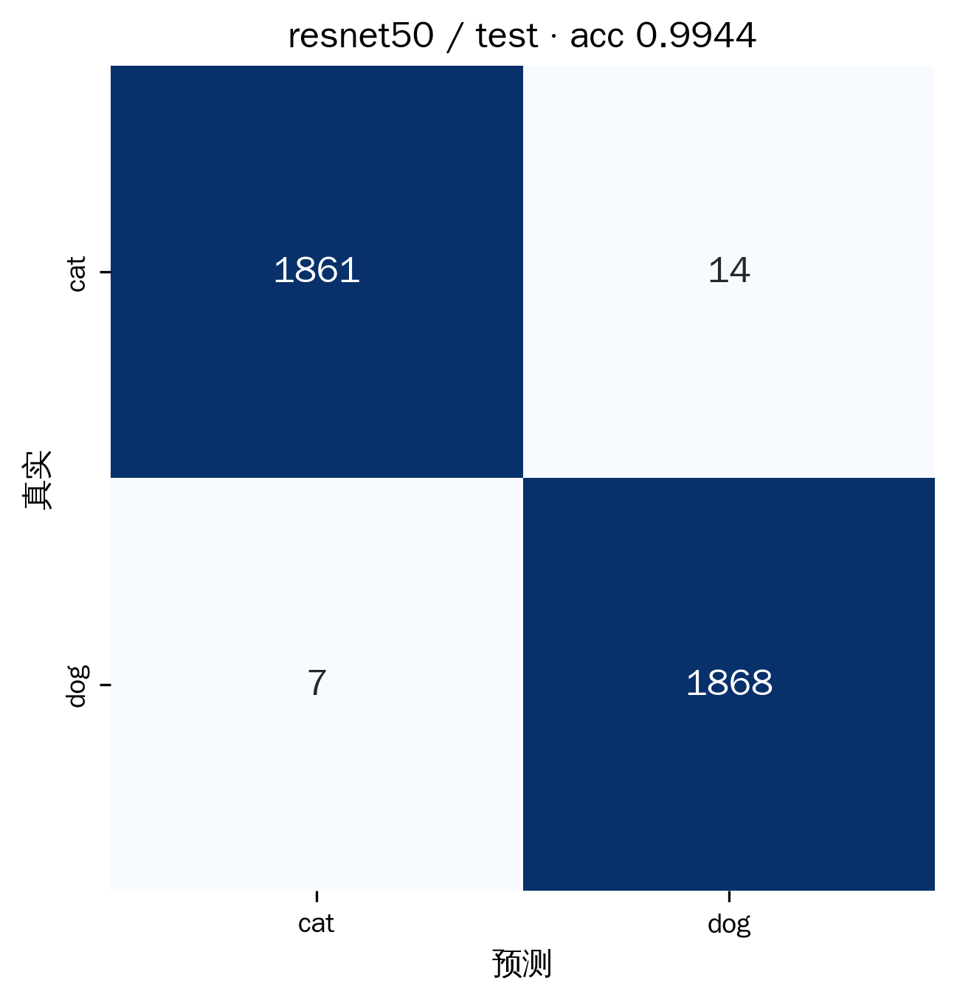

# 猫狗分类：VGGNet / ResNet / SE-ResNet 复现与迁移学习

## 摘要
用 PyTorch 从零手写 VGG16、ResNet18/50，并在 ResNet50 的残差分支上集成 SE 注意力模块，加载 ImageNet 官方预训练权重后在 Kaggle Cats vs Dogs 上微调，并在校园实拍图上做定性检验。

**主要结论**：七组实验的测试准确率全部超过 98%。最高的 99.44% 由**可训练参数仅 4098 的 ResNet50 冻结组**取得，并不来自最大（参数最多）的模型。而可训练参数 1.34 亿、训练时间 4 倍的 VGG16 全量微调反而最低，98.29%。不过二者差距也只有1.15%。**在这个任务上，精度差异主要来自结构选择,** 和微调精度关系并不大。

## 结果

使用同一测试集（3750 张），同一份训练设置，单张 RTX 4090D，总计 38 分钟。

| # | 模型 | 模式 | 可训练参数 | 最好 epoch | val acc | **test acc** | test loss | train−val | 训练时长 |
|---|---|---|---|---|---|---|---|---|---|
| 1 | VGG16 | 全量微调 | 134,268,738 | 8 | 0.9813 | 0.9829 | 0.0537 | 0.0154 | 7m24s |
| 2 | VGG16 | 冻结主干 | 8,194 | 4 | 0.9877 | 0.9888 | 0.0327 | 0.0000 | 1m57s |
| 3 | ResNet18 | 全量微调 | 11,177,538 | 8 | 0.9888 | 0.9904 | 0.0325 | 0.0107 | 4m05s |
| 4 | ResNet18 | 冻结主干 | 1,026 | 3 | 0.9840 | 0.9877 | 0.0357 | 0.0047 | 1m57s |
| 5 | ResNet50 | 全量微调 | 23,512,130 | 5 | 0.9912 | 0.9907 | 0.0252 | 0.0063 | 6m11s |
| 6 | ResNet50 | 冻结主干 | 4,098 | 3 | 0.9936 | **0.9944** | 0.0157 | 0.0034 | **1m54s** |
| 7 | SE-ResNet50 | 全量微调 | 26,027,074 | 6 | 0.9912 | 0.9883 | 0.0323 | 0.0072 | 7m27s |

## 表现






---

## 1. 代码实现：手写 VGGNet / ResNet / SE-ResNet

手写四个网络（`models/`），没有用 `torchvision.models` 的现成类。

| 模型 | 总参数（2 分类） | 结构 |
|---|---|---|
| VGG16 | 134.3 M | 5 段 3×3 卷积（最大池化下采样）+ `AdaptiveAvgPool(7,7)` + 3 层全连接（4096-4096-2） |
| ResNet18 | 11.18 M | `BasicBlock` × 8，`[2,2,2,2]` |
| ResNet50 | 23.51 M | `Bottleneck` × 16，`[3,4,6,3]`，stride 放在瓶颈中间的 3×3 卷积上 |
| SE-ResNet50 | 26.03 M | `SEBottleneck` 继承 `Bottleneck`，在残差相加**之前**做通道重标定 |

**SE 模块**（`models/se_resnet.py`）：先 `AdaptiveAvgPool2d(1)` 把每个通道压成一个数（squeeze），过两层全连接做降维再升维（reduction=16），Sigmoid 得到 0~1 的门控系数（excitation），最后逐通道乘回特征图。


**框架**（参考 MMPretrain）：配置与代码分离，`configs/_base_/` 放公共项，每个模型只写有差异的部分，在`tools/train.py --config` 里做驱动，每次训练用一个独立的 run 目录，最后四个模型能共享同一套训练/评估代码。

## 2. 预训练权重加载

权重来源是 `torchvision` 的官方枚举（`VGG16_Weights.DEFAULT` 等），用 `get_state_dict()` 带 hash 校验下载。

**加载策略是按名字 + shape 匹配，没有整份 `load_state_dict`**：

```python
for name, weight in pretrained_state.items():
    if name not in model_state:            continue   # 预训练有、我们没有 → 跳过
    if model_state[name].shape != weight.shape:        # 比如 1000 类的 fc
        shape_mismatched.append(name)                  # → 跳过
        continue
    matched[name] = weight
model.load_state_dict(matched, strict=False)
```

好处是换分类头时不需要手工写"排除 fc"的规则，1000 类的 `fc.weight` 和 2 类的 `fc.weight` shape 不同，自动被跳过。实测覆盖率：

| 模型 | 匹配张量数 | 参数覆盖率 | 未加载 |
|---|---|---|---|
| VGG16 | 30 | 99.99% | `classifier.6.weight/bias` |
| ResNet18 | 120 | 99.99% | `fc.weight/bias` |
| ResNet50 | 318 | 99.98% | `fc.weight/bias` |

**SE-ResNet50 的特殊情况**：没有公开的 SE 预训练权重，所以它加载的是 **ResNet50 的权重**，`se.fc.*` 这 4 个张量没有对应项、保持随机初始化。

## 3. 迁移学习

### 3.1 训练配方

| 项 | 全量微调 | 冻结主干 |
|---|---|---|
| 可训练参数 | 全部 | 只有最后一层（VGG16 为 `classifier[-1]`，其余为 `fc`） |
| 优化器 / 学习率 | AdamW, 1e-4（VGG16 2e-4） | AdamW, 1e-3 |
| epochs | 10 | 5 |
| 调度 | warmup 1 epoch + cosine（按 iteration） | cosine（无 warmup，线性层不需要） |
| 精度 | bf16 autocast | bf16 |
| batch | 32（VGG16 为 16） | 同左 |

**说明**：

- 【冻结】指的是是**只训最后一层**，不是一般说的【冻结 features、训整个 classifier】。VGG16 的 `classifier` 是三层全连接、共 1.19 亿参数，把整个 classifier 解冻等于没冻结，所以取 `classifier[-1]`，让四个模型的可训练参数在同一数量级上（1026 / 4098 / 8194）。
- 同时冻结时**必须把 BN 层切到 eval**，否则 `running_mean/var` 还是会随 batch 更新，而且 `model.train()` 每轮会把它调回去，所以要在训练里每轮重设。
- SE-ResNet50 没有做冻结实验，因为它的 SE 层本来就是随机初始化，冻结之后这批随机权重永不更新，没有对SE结构起到训练作用。


### 3.2 结果

要求是 >95%，七组全部达标，最低 98.29%，最高 99.44%。





上面两张图是实验的两个极端

- **VGG16 全量微调**：训练损失一路降到 0.003，但验证损失从 epoch 7 的 0.0562 一直升到 epoch 10 的 0.0644 ，这也是整个表唯一一条验证损失持续升高的曲线，过拟合相对比较明显了。我认为是1.34 亿可训练参数对 1.75 万张训练图来说容量严重过剩。
- **ResNet50 冻结**：只有 4098 个参数，训练和验证两条曲线几乎贴在一起，第 3 轮就到 99.36%，最后 test 99.44%。

实际上这次训练的很多其他模型也是像ResNet50这样，实际上在很早的epoch就已经基本收敛了，后面提升的几乎是微乎其微。

### 3.3 讨论

**①冻结的反超**

| 模型 | 全量 | 冻结 | 差值 |
|---|---|---|---|
| VGG16 | 98.29 | 98.88 | +0.59 |
| ResNet18 | 99.04 | 98.77 | −0.27 |
| ResNet50 | 99.07 | 99.44 | +0.37 |

三个差值里有两个落在 ±0.45% 的噪声范围内，VGG16 也差的不大，所以在这次的实验，**在这种训练设置下，冻结与全量在精度上可以说没有区别，但冻结只用了 1/5700 到 1/16000 的可训练参数和约 1/3 的训练时间**。

这几个模型第 1 轮 val 就到 97-98%，说明 ImageNet 特征对"猫狗"这个任务已经接近充分了，10 个 epoch + 余弦衰减到 0，主干网络实际上没有多少移动空间，全量微调学到的主要是训练集的细节（train acc 99.9% vs val 98.9%）。这时冻结组给线性分类头 1e-3 的学习率，反而能让最后一层收敛得更好。

**②VGG16 最差、过拟合最重**

VGG16是参数量最大、训练最久、精度最低的一组。我认为关键在于**迁移学习的场景下 1.34 亿可训练参数绰绰有余，甚至大概是一种负担和累赘**。分类器三层全连接就有 1.19 亿参数，但是目标任务只有 2 类共1.75 万张图。

**③ SE 模块没有带来增益**

SE-ResNet50 测试 98.83，反而低于主干骨架的 ResNet50（99.07），不过实际上也差得不多。一是SE块给的是随机参数。10个epoch来不及让表现达到收敛，二是这个任务比较简单，各模型都基本快满分了，所以在简单任务下SEBlock不能带来很大的提升。

### 3.4 多卡训练与测试（DDP）

DDP只做了代码实现，没有做多卡实测

启动方式必须要用torchrun

```bash
torchrun --nproc_per_node=2 -m tools.train --config configs/resnet50.py --train-mode full \
    --data-root /path/PetImages --work-root /path/work_dirs
torchrun --nproc_per_node=2 -m tools.test  --config configs/resnet50.py --train-mode full \
    --data-root /path/PetImages --work-root /path/work_dirs
```

改动的地方：

1. **进程初始化**（`utils.setup_distributed`）：从 torchrun 提供的 `WORLD_SIZE / RANK / LOCAL_RANK` 环境变量判断，没有这些变量就走单卡路径（`distributed=False`），所以同一份代码也能在单卡上跑
2. **数据分片**（`dataset.build_dataloaders`）：每个进程一个 `DistributedSampler`，训练集 `shuffle=True` 且 `drop_last=True`（各卡样本数对齐），验证/测试集 `shuffle=False`；`DataLoader` 的 `shuffle` 必须关掉，不然会和 sampler 冲突。每个 epoch 还要调 `sampler.set_epoch(epoch)`。
3. **梯度指标同步**：模型包了一层 `DistributedDataParallel`，梯度由它的 all-reduce 负责，`AverageMeter.sync()` 里对 `total/count` 做 `all_reduce`，所以打印出来的 loss/acc 是全局值。
4. **多卡测试合并**：`evaluate` 每个进程只算自己的，由于`DistributedSampler` 在除不尽时会补齐重复样本，不去重会把指标算偏，所以之后用 `all_gather_object` 把 `(预测, 标签, 数据集下标)` 收集起来，按下标合并去重，

多卡下的实际吞吐、NCCL 通信开销、`DistributedSampler` 补齐边界由于没有在多卡实机上跑过，所以还没有去验证过

## 4. 数据分析与可视化

TensorBoard 每个 run 记 5 条曲线（`Loss/train`、`Loss/val`、`Accuracy/train`、`Accuracy/val`、`LearningRate`），写在 run 目录的 `tensorboard/` 下：

```bash
tensorboard --logdir work_dirs
```

混淆矩阵（ResBet50-freeze）：



3750 张里错 21 张（猫误判成狗 14 张，狗误判成猫 7 张）。猫错得多一倍，但绝对数量只有14张，实际表现已经收敛。

## 5. 实地测试

把手机拍的猫狗照片直接喂进模型，输出带置信度的标注图和 csv：

```bash
python -m tools.inference --config configs/resnet50.py --input D:\photos\campus --save-dir D:\photos\out
# 或者同时看几个模型的判断
python -m tools.inference --config configs/resnet50.py --input D:\photos\campus --compare resnet18,se_resnet50
```

输出：`{原名}_pred.jpg`（外框 + 预测类别 + 置信度）、`result.csv`（每张图的预测、置信度、两类概率）

**照片不参与训练和测试**


## 6. 局限

1. **单 seed**：每组只跑一次，没有泛化去看误差。
2. **只有 10 个 epoch**：配了 cosine 衰减，末轮 lr 接近 0，没有验证更长 schedule 是否会改变排序。
3. **`weight_decay` 没有调**：AdamW 直接用的 1e-4，而它的惯用量级是 0.01~0.05，实际几乎等于没有正则。
4. **SE 只试了一种集成方式**（残差相加前重标定），没有和"相加后重标定"或"SE 层单独给学习率"对照。
5. **DDP 未实测**

## 7. 快速开始

```bash
uv sync                                                  # 或 pip install torch torchvision matplotlib scikit-learn seaborn tensorboard
python -m tools.train --config configs/resnet50.py --train-mode full
python -m tools.test  --config configs/resnet50.py --train-mode full
python -m tools.analysis
```
